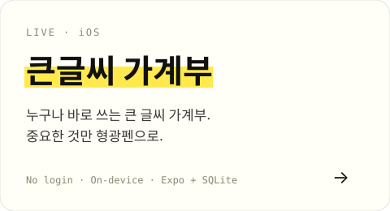
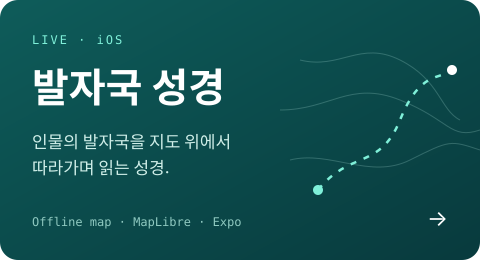

 

### Shipped

<table>
<tr>
<td width="50%"></td>
<td width="50%"></td>
</tr>
</table>

&nbsp;&nbsp;Now building — 진짜 물리로 움직이는 초등 과학 앱, 그리고 아직 공개 전인 몇 가지.

  

### Stack

  

<picture>
  <source media="(prefers-color-scheme: dark)" srcset="https://raw.githubusercontent.com/ooohi000/ooohi000/output/github-snake-dark.svg" />
  
</picture>

<a href="mailto:ooohi00011@gmail.com">ooohi00011@gmail.com</a>

